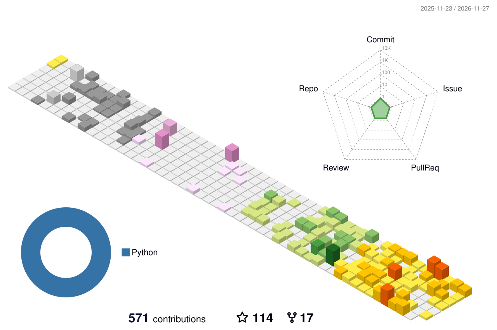

<a href="https://sazzadul.com/">
<picture>
  <source media="(prefers-color-scheme: dark)" srcset="./assets/hero-dark.svg" />
  
</picture>
</a>

<h1 align="center">Md. Sazzadul Islam — Software Engineer &amp; Project Manager</h1>

  <b>SAP ABAP · Laravel · Flutter · Vue.js</b> 
  Enterprise software, ERP and business automation from Dhaka, Bangladesh.

  
  
  
  

<h2> About</h2>

<table>
  <tr>
    <td valign="top" width="62%">
      
I started as a web developer in 2015 and have spent the years since moving closer to the business: from client PHP projects, to ERP modules, to leading software delivery across departments at <b>Super Star Group</b>.

      
Today I work as <b>Deputy Manager (Project Manager)</b>, and I still write code. My job is to take an operational requirement, turn it into reliable, scalable software, and stay with it through UAT, rollout and support, until the system is simply part of the routine.

      
<i>“You can imagine, I can do.”</i>

      
<b>Now:</b> leading AI Sales Intelligence at Super Star Group 
      <b>Daily platforms:</b> SAP, web and mobile 
      <b>Based in:</b> Dhaka, Bangladesh 
      <b>Languages:</b> Bangla (native), English (professional)

    </td>
    <td valign="top" width="38%">
      <picture>
        <source media="(prefers-color-scheme: dark)" srcset="./assets/portrait-dark.svg" />
        
      </picture>
    </td>
  </tr>
</table>

<h2> Tech stack</h2>

<picture>
  <source media="(prefers-color-scheme: dark)" srcset="./assets/stack-dark.svg" />
  
</picture>

| Area | What I use |
| :-- | :-- |
| **Enterprise & SAP** | SAP ABAP, ERP for sales, inventory and production, budgeting |
| **Backend** | PHP, Laravel, CodeIgniter, Node.js, REST APIs, integrations |
| **Mobile & frontend** | Flutter, Dart, Android, Ionic, Vue.js |
| **Data** | MySQL, MariaDB, PostgreSQL, MongoDB, query optimization, reporting |
| **Tools** | Git, Linux, API testing, deployment, performance tuning |
| **Software & project** | Architecture, requirement analysis, SDLC, project delivery, team coordination |

<h2> What I'm building</h2>

<table>
  <tr>
    <td valign="top" width="50%">
      <b>AI Sales Intelligence</b> in development 
      Natural-language questions over sales and data-warehouse sources, with KPI analysis and management reporting. 
      Role: leading design and development
    </td>
    <td valign="top" width="50%">
      <b>Sales Automation</b> 
      Mobile and all-channel ordering platform with offer and plan workflows and sales-force APIs. 
      Role: requirements, UAT and rollout, end to end
    </td>
  </tr>
  <tr>
    <td valign="top">
      <b>Product Tracking &amp; Warranty</b> 
      Follows every product code from factory to distributor, with warranty workflows on top. 
      Role: delivery lead
    </td>
    <td valign="top">
      <b>SAP ABAP Development &amp; Integration</b> 
      Custom ABAP, finance enhancements, reporting, and SAP connected to in-house applications. 
      Role: ABAP development and integration
    </td>
  </tr>
  <tr>
    <td valign="top" colspan="2">
      <b>Business Automation</b> 
      Cross-department workflow digitization: tasks, services, approvals and operational reporting. 
      Role: initiative lead
    </td>
  </tr>
</table>

<h2> How I deliver</h2>

<picture>
  <source media="(prefers-color-scheme: dark)" srcset="./assets/deliver-dark.svg" />
  
</picture>

<h2> Experience</h2>

<picture>
  <source media="(prefers-color-scheme: dark)" srcset="./assets/journey-dark.svg" />
  
</picture>

| When | Role | Where | Focus |
| :-- | :-- | :-- | :-- |
| **Jul 2022 – now** | Deputy Manager (Project Manager) | Super Star Group | Software and business automation across departments: ERP, sales automation, workflows, SAP and custom-app integration |
| Aug 2021 – Jul 2022 | Senior Executive, Software Engineer | Gemcon Group | HRMS mobile apps with Flutter, Laravel and Vue.js; POS and asset management |
| Apr 2019 – Jul 2021 | Senior Executive, Software Engineer | Super Star Group | ERP modules for inventory, sales and production; offline Android sales app; budgeting and service workflows |
| May 2017 – Mar 2019 | Software Developer | ABH World | CRM and accounting solutions; e-commerce and service software |
| Oct 2015 – Apr 2017 | Jr. Web Developer | Ronova-it Ltd. | Custom web applications for education, healthcare and hospitality clients |

**Education:** BSc in Computer Science &amp; Engineering, Bangladesh University of Business and Technology (2018) · Diploma in Engineering (Computer Technology), Noakhali Ideal Polytechnic Institute (2014)

<h2> Writing</h2>

- [Offline-First Sales Apps: Design for No Network](https://sazzadul.com/blog/offline-first-sales-apps)
- [Laravel Performance Tuning: A Practical Checklist](https://sazzadul.com/blog/laravel-performance-tuning)
- [SAP and Laravel Integration: Patterns That Work](https://sazzadul.com/blog/sap-laravel-integration-patterns)

<h2> GitHub activity</h2>

<picture>
  <source media="(prefers-color-scheme: dark)" srcset="./profile-3d-contrib/profile-night-rainbow.svg" />
  
</picture>

<picture>
  <source media="(prefers-color-scheme: dark)" srcset="./assets/stats-dark.svg" />
  
</picture>

  <picture>
    <source media="(prefers-color-scheme: dark)" srcset="https://streak-stats.demolab.com/?user=md-sazzadul-islam&hide_border=true&border_radius=24&background=1b1113&ring=ff7a80&fire=ff7a80&currStreakLabel=ff7a80&currStreakNum=f6eeec&sideNums=f6eeec&sideLabels=b7a6a8&dates=b7a6a8&stroke=3d0f13" />
    
  </picture>

<h2> Get in touch</h2>

<a href="https://sazzadul.com/">
<picture>
  <source media="(prefers-color-scheme: dark)" srcset="./assets/contact-dark.svg" />
  
</picture>
</a>

  <a href="https://sazzadul.com/">Website</a> ·
  <a href="mailto:sazzadulislam6@gmail.com">Email</a> ·
  <a href="https://www.linkedin.com/in/mdsazzadulislam/">LinkedIn</a> ·
  <a href="https://x.com/sazzadul1">X</a> ·
  <a href="https://www.instagram.com/sazzadul_com/">Instagram</a> ·
  <a href="https://www.facebook.com/@sazzadulislam.rasel.3">Facebook</a>

  

